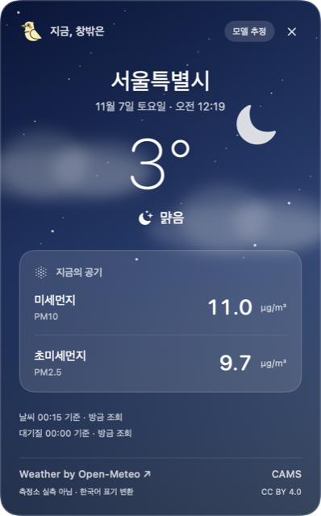
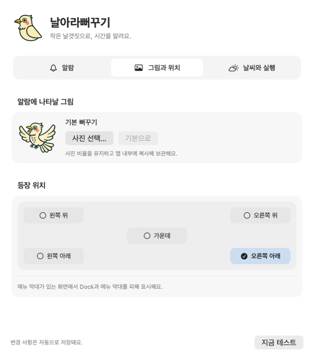

<h1 align="center">날아라뻐꾸기</h1>

<b>BBUGGUKK</b> — 정각에는 뻐꾹, 마우스를 올리면 지금의 하늘.

  <a href="https://github.com/pastorpark/bbuggukk-releases/releases/download/v1.4.0/BBUGGUKK-1.4.0-macOS-universal.dmg"><b>⬇︎ 1.4.0 체험판 DMG 다운로드</b></a>
  · <a href="https://github.com/pastorpark/bbuggukk-releases/releases">릴리스 목록</a>

macOS 메뉴바에 상주하는 작은 뻐꾸기 시계입니다. 정각마다 화면 구석에 뻐꾸기가 날아와 실제 뻐꾸기 녹음으로 시간을 알리고, 메뉴바 아이콘에 마우스를 올리면 지금 날씨와 미세먼지를 보여 줍니다. Dock 아이콘이나 기본 창 없이 동작하며, 캐릭터가 나타나도 작업 중인 앱의 입력을 방해하지 않습니다.

이 저장소는 앱 다운로드와 문제 제보를 위한 공간입니다.

<table>
  <tr>
    <td align="center" width="33%"> 정각 알림 · 날개를 펴고 뻐꾹!</td>
    <td align="center" width="33%"> 아이콘에 마우스를 올리면 지금의 하늘</td>
    <td align="center" width="33%"> 그림과 위치 설정</td>
  </tr>
</table>

## 1.4.0의 새로운 점

- **새 이름과 디자인**: 앱 이름이 **날아라뻐꾸기**로 바뀌었습니다. 앱 아이콘, 메뉴바 아이콘 , 정각 알림 캐릭터와 날씨 카드·설정 창의 그림을 새 캐릭터로 바꿨습니다.
- **정각 알림 움직임**: 캐릭터가 양 날개를 펴고 위아래로 흔들리며 웁니다. 시스템의 **동작 줄이기**를 켜면 움직이지 않습니다.
- **메모리 절약**: 설정 창을 닫으면 메모리에서 해제하고, 사진·소리를 필요한 만큼만 읽도록 바꿔 항상 켜 두는 앱의 부담을 줄였습니다.

## 설치와 실행

1. DMG를 열고 **날아라뻐꾸기.app**을 **Applications** 폴더로 끌어 놓습니다.
2. 이전 버전이 실행 중이면 메뉴바에서 **종료**합니다. 1.3.0(**날수있다뻐꾸기.app**)을 쓰셨다면 이름이 달라 자동으로 교체되지 않으니, 응용 프로그램 폴더에서 이전 앱을 휴지통으로 옮겨 주세요. 설정은 그대로 이어집니다.
3. 응용 프로그램 폴더의 앱을 실행합니다. Dock에는 나타나지 않고 메뉴바에 뻐꾸기 아이콘이 생깁니다.
4. 출처를 확인하고 이 체험판 실행을 신뢰하는 경우, 실행을 한 번 시도한 뒤 **시스템 설정 → 개인정보 보호 및 보안 → 그래도 열기**를 사용할 수 있습니다. OS·관리 정책에 따라 허용되지 않을 수 있습니다. [Apple의 공식 안내](https://support.apple.com/ko-kr/102445)를 참고하세요.

DMG 안에서 바로 실행하지 말고 응용 프로그램 폴더에 복사하세요. 이전 버전에서 **로그인 시 실행**을 켜 두셨다면 새 앱의 설정에서 한 번 껐다가 다시 켜 주세요.

**현재 배포본은 Developer ID 서명·Apple 공증 전 체험판입니다.** 로컬 ad hoc 서명만 적용되어 다운로드 후 macOS가 실행을 차단할 수 있습니다. 일반 사용자를 위한 정식 서명·공증 배포는 추후 진행합니다.

최소 대상은 macOS 13이며 Apple Silicon과 Intel 바이너리를 함께 담았습니다. 실행 확인 환경은 macOS 26.6.2 / Apple Silicon이고, Intel 바이너리는 같은 Mac의 Rosetta에서 실행만 확인했습니다. macOS 13과 Intel 실기기는 아직 검증하지 않았습니다.

## 사용법

- 아이콘에 마우스를 약 0.5초 올리면 날씨와 미세먼지 카드가 나타납니다. 메뉴의 **날씨 창 보기**로도 열 수 있습니다.
- **설정 → 알람**: 정각에 한 번 또는 시간 숫자만큼 울리기, 울리는 시간 제한, 소리 조절, 3회 미리듣기.
- **설정 → 그림과 위치**: 원하는 사진 선택, 기본 캐릭터 복원, 화면 가운데 또는 네 모서리 선택.
- **설정 → 날씨와 실행**: 도시 검색, 날씨 표시, 로그인 시 실행, 출처 확인.
- **지금 테스트**로 알람을 확인하고 **종료**로 앱을 끝냅니다. 설정은 자동 저장됩니다.

날씨 배경은 선택 도시의 날씨·일출·일몰에 맞춰 바뀝니다. 사진은 이 Mac의 앱 지원 폴더에 복사됩니다. 도시 검색어와 선택 위치는 날씨 공급자에게 조회 요청으로 전송되며 GPS 권한은 사용하지 않습니다.

## 알려진 제한

- 무료 개인용·비상업 체험판입니다. 날씨는 Open-Meteo 무료 비상업 API를 사용합니다.
- 날씨와 미세먼지는 모델 추정값이며 측정소 실시간 관측값과 다를 수 있습니다. 자료 시각과 출처를 카드에서 확인하세요.
- 앱 종료·Mac 잠자기 중에는 알람이 울리지 않으며 놓친 알람을 나중에 몰아서 울리지 않습니다.
- 화면이 켜진 잠금 감지는 최선 노력입니다. OS 변경으로 실패하면 소리가 날 수 있습니다. 전체 화면 위 그림 표시는 보장하지 않습니다.
- 자동 업데이트는 아직 없습니다. 새 버전은 이 저장소의 Releases에서 받습니다.

## 출처

알람 음원은 Jugrü의 [Kuckuck](https://commons.wikimedia.org/wiki/File:Kuckuck.ogg)을 발췌·필터링·페이드·음량 조절한 편집본입니다. 편집 음원과 반복 배경음은 원본과 같은 [CC BY-SA 3.0](https://creativecommons.org/licenses/by-sa/3.0/)으로 제공됩니다. 상세 내용은 [Sound-LICENSE.txt](Sound-LICENSE.txt)와 앱의 출처 안내를 참고하세요. 이 라이선스는 해당 음원에 적용됩니다.

메뉴바 아이콘: <a href="https://www.flaticon.com/kr/free-icons/" title="뻐꾸기 아이콘">뻐꾸기 아이콘 제작자: Magnific - Flaticon</a>. 앱 아이콘과 캐릭터는 AI 이미지 생성(Google Gemini · ChatGPT)으로 만든 이 앱 전용 그림입니다.

날씨: [Open-Meteo](https://open-meteo.com/) · 미세먼지: [CAMS](https://atmosphere.copernicus.eu/) · 도시: [GeoNames](https://www.geonames.org/). 데이터 [CC BY 4.0](https://creativecommons.org/licenses/by/4.0/). 한국어 표기와 반올림을 적용했습니다. 앱 내 출처에 상세 링크가 있습니다.

문제는 이 저장소의 Issues에 macOS 버전, Mac 종류, 재현 순서를 적어 남겨 주세요.
